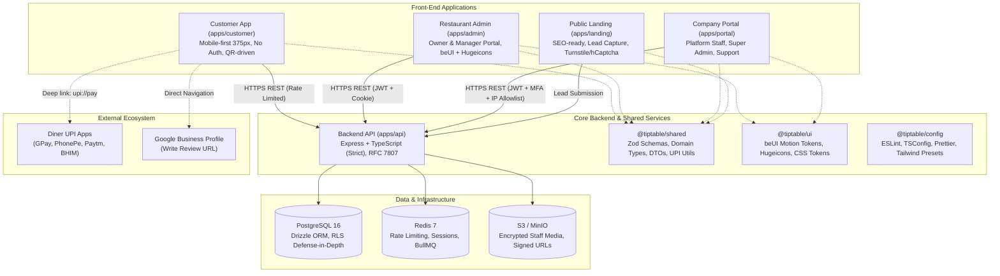
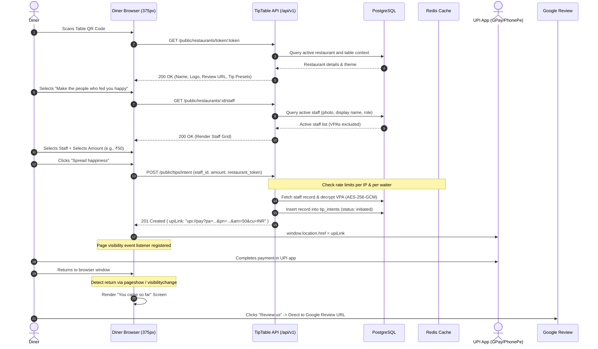
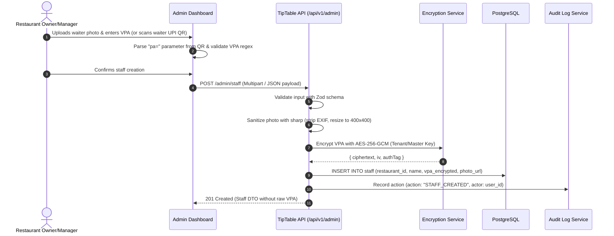

# TipTable System Architecture

This document provides a comprehensive architectural blueprint for **TipTable**, a multi-tenant SaaS platform empowering restaurant diners in India to tip waitstaff directly via UPI deep links and leave Google reviews without platform intermediary custody of funds.

---

## 1. System Overview

TipTable is organized as a unified monorepo with 4 client applications, 1 core API service, and 3 shared internal packages.



---

## 2. Monorepo Structure

We use `pnpm` workspaces configured with strict package boundaries:

```text
rwrd/
├── apps/
│   ├── api/               # Express REST API (/api/v1)
│   ├── customer/          # Public diner flow (375px mobile-first)
│   ├── admin/             # Restaurant management portal (beUI + Hugeicons)
│   ├── portal/            # Platform internal management (Super Admin / Support)
│   └── landing/           # Public marketing & lead generation site
├── packages/
│   ├── shared/            # Shared Zod schemas, types, DTO contracts, UPI generators
│   ├── ui/                # Shared beUI motion components, design tokens, Hugeicons
│   └── config/            # Shared linting, formatting, and TypeScript configurations
├── docs/                  # Architecture, decisions, runbooks, schemas, security
└── docker-compose.yml     # Local infrastructure (Postgres, Redis, MinIO, API)
```

---

## 3. Detailed Data & Transaction Flows

### 3.1 Customer Scan to UPI Deep Link Flow

The customer flow never handles money directly. The backend validates the restaurant token, verifies the selected staff member, logs the tip intent, and provides a formatted UPI deep link.



### 3.2 Staff VPA Onboarding & Encryption Flow

Waitstaff Virtual Payment Addresses (VPAs) are sensitive financial identifiers. They must be validated for proper format, encrypted at rest using AES-256-GCM, and protected against accidental typos or scrapers.



---

## 4. Backend Layered Architecture

To ensure strict separation of concerns, testability, and enterprise maintainability, `apps/api` adheres strictly to this structure:

```text
┌────────────────────────────────────────────────────────┐
│                     HTTP Routes                        │
│   (/api/v1/public, /api/v1/admin, /api/v1/portal)      │
│   - Route-level rate limiting (Redis)                  │
│   - Authentication & RBAC middleware                   │
│   - Request validation (Zod schema middleware)         │
└───────────────────────────┬────────────────────────────┘
                            │
┌───────────────────────────▼────────────────────────────┐
│                     Controllers                        │
│   - Extract validated params, query, body              │
│   - Delegate directly to Domain Services               │
│   - Map domain results to standard DTOs                │
│   - Format errors into RFC 7807 problem+json           │
└───────────────────────────┬────────────────────────────┘
                            │
┌───────────────────────────▼────────────────────────────┐
│                   Domain Services                      │
│   - Business logic, invariants, and validation rules   │
│   - Orchestrate crypto, transactions, and audit logs   │
│   - Enforce tenant isolation logic                     │
│   - Emit background jobs (BullMQ)                      │
└───────────────────────────┬────────────────────────────┘
                            │
┌───────────────────────────▼────────────────────────────┐
│                    Repositories                        │
│   - Direct Drizzle ORM queries                         │
│   - Mandatory restaurant_id parameterization           │
│   - Encapsulate SQL constraints and transactions       │
└───────────────────────────┬────────────────────────────┘
                            │
┌───────────────────────────▼────────────────────────────┐
│               PostgreSQL 16 (with RLS)                 │
└────────────────────────────────────────────────────────┘
```

---

## 5. Technology Decisions & Rationale

| Layer                   | Choice                            | Rationale                                                                                                            |
| :---------------------- | :-------------------------------- | :------------------------------------------------------------------------------------------------------------------- |
| **Monorepo Manager**    | `pnpm` workspaces                 | Fast, deterministic disk space savings, native workspace isolation, strict dependency graph.                         |
| **Database ORM**        | Drizzle ORM                       | High-performance, lightweight, SQL-like type safety, zero runtime overhead, native migration engine (`drizzle-kit`). |
| **Backend Framework**   | Node.js + Express + TS            | Industry standard, robust middleware ecosystem, enterprise observability support.                                    |
| **Cache & Queue**       | Redis 7 + BullMQ                  | Low-latency rate limiting, token family revocation, and reliable background job handling.                            |
| **Motion & UI**         | `beUI` + `@hugeicons/react`       | Product-grade micro-interactions, spring physics, accessibility (reduced-motion tokens), cohesive SVG stroke icons.  |
| **Customer Typography** | Self-hosted Newsreader / Fraunces | Warm, sophisticated editorial tone matching Claude's aesthetic without runtime CDN calls or third-party cookies.     |
| **Data Protection**     | AES-256-GCM + Argon2id            | Industry gold standard for column encryption (VPAs) and credential hashing.                                          |

---

## 6. Core Architectural Invariants

### 6.1 100% Anonymous Diner Tipping Flow

- **Zero Diner Identification**: Diners are completely anonymous. No customer name, email, phone number, or payment card data is ever requested, captured, or stored anywhere in the application or database.
- **Direct UPI Intent**: Diners interact solely with waiter selection and amount presets before launching out-of-band UPI deep links (`upi://pay`).

### 6.2 Single Restaurant Admin Model

- **Strictly One Admin User per Tenant**: A PostgreSQL unique constraint (`uq_restaurant_users_restaurant_id`) enforces that every restaurant has at most one administrator account.
- **Unified Role**: The previous two-tier `owner` vs `manager` role hierarchy is replaced with a single unified `admin` role with full administrative authority over their restaurant's profile, staff roster, and QR placements.
