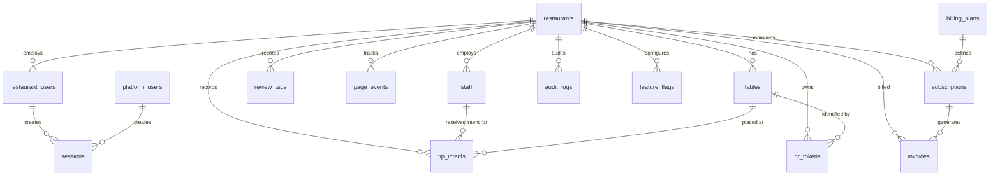

# TipTable Database Data Model & Tenancy Specifications

This document defines the PostgreSQL 16 relational data model managed via **Drizzle ORM**. It details table schemas, column types, relationships, indexes, constraints, multi-tenancy isolation policies, and DPDP Act compliance rules.

---

## 1. Core Tenancy & Schema Rules

1. **Primary Keys**: All primary keys are `UUID` (generated via UUIDv7 or `gen_random_uuid()`) to eliminate enumeration attacks and preserve sequential insert performance.
2. **Multi-Tenancy Invariant**:
   - Every tenant-scoped table contains a mandatory `restaurant_id UUID NOT NULL REFERENCES restaurants(id) ON DELETE CASCADE`.
   - All Drizzle queries in `apps/api/src/repositories` must parameterize `WHERE restaurant_id = :tenant_id`.
   - PostgreSQL Row-Level Security (RLS) is enabled on tenant tables as defense-in-depth:
     ```sql
     ALTER TABLE staff ENABLE ROW LEVEL SECURITY;
     CREATE POLICY tenant_isolation_policy ON staff
       FOR ALL
       USING (restaurant_id = current_setting('app.current_restaurant_id', true)::uuid);
     ```
3. **Audit Trails & Soft Deletes**:
   - Sensitive entities (`restaurants`, `staff`, `restaurant_users`) implement soft deletion via `deleted_at TIMESTAMP WITH TIME ZONE`. Queries must filter `deleted_at IS NULL` unless explicitly requesting archived records.
   - All tables include `created_at TIMESTAMP WITH TIME ZONE DEFAULT NOW() NOT NULL` and `updated_at TIMESTAMP WITH TIME ZONE DEFAULT NOW() NOT NULL`.
4. **Data Minimization (DPDP Compliance)**:
   - We **never** store customer names, phone numbers, UPI VPAs, payment identifiers, or banking credentials in `tip_intents` or `page_events`.
   - Device information is strictly coarse (e.g., `os: 'Android'`, `browser: 'Chrome'`) without fingerprinting.

---

## 2. Entity Relationship Diagram



---

## 3. Table Definitions

### 3.1 `restaurants`

Stores restaurant tenant accounts.

```sql
CREATE TABLE restaurants (
    id UUID PRIMARY KEY DEFAULT gen_random_uuid(),
    name VARCHAR(255) NOT NULL,
    slug VARCHAR(100) UNIQUE NOT NULL,
    logo_url TEXT, -- In-browser canvas crop base64 data URL or external asset URL (Postgres TOAST-compressed)
    google_review_url VARCHAR(1024) NOT NULL,
    tip_presets INT[] DEFAULT '{20, 50, 100, 200}' NOT NULL,
    min_tip_inr INT DEFAULT 1 NOT NULL,
    max_tip_inr INT DEFAULT 10000 NOT NULL,
    is_active BOOLEAN DEFAULT TRUE NOT NULL,
    is_suspended BOOLEAN DEFAULT FALSE NOT NULL,
    suspension_reason TEXT,
    created_at TIMESTAMP WITH TIME ZONE DEFAULT NOW() NOT NULL,
    updated_at TIMESTAMP WITH TIME ZONE DEFAULT NOW() NOT NULL,
    deleted_at TIMESTAMP WITH TIME ZONE,
    CONSTRAINT check_tip_bounds CHECK (min_tip_inr > 0 AND max_tip_inr >= min_tip_inr)
);

CREATE INDEX idx_restaurants_slug ON restaurants(slug) WHERE deleted_at IS NULL;
CREATE INDEX idx_restaurants_active ON restaurants(is_active) WHERE is_suspended = FALSE;
```

### 3.2 `restaurant_users`

The primary administrator account belonging to a specific restaurant. Structurally enforced to allow **strictly one admin account per restaurant** via `uq_restaurant_users_restaurant_id`.

```sql
CREATE TABLE restaurant_users (
    id UUID PRIMARY KEY DEFAULT gen_random_uuid(),
    restaurant_id UUID NOT NULL REFERENCES restaurants(id) ON DELETE CASCADE,
    email VARCHAR(255) NOT NULL,
    password_hash VARCHAR(255) NOT NULL, -- Argon2id
    full_name VARCHAR(255) NOT NULL,
    role VARCHAR(50) DEFAULT 'admin' NOT NULL, -- 'admin'
    is_active BOOLEAN DEFAULT TRUE NOT NULL,
    totp_secret_encrypted VARCHAR(512),
    totp_enabled BOOLEAN DEFAULT FALSE NOT NULL,
    totp_recovery_codes_hash TEXT[],
    failed_login_attempts INT DEFAULT 0 NOT NULL,
    locked_until TIMESTAMP WITH TIME ZONE,
    created_at TIMESTAMP WITH TIME ZONE DEFAULT NOW() NOT NULL,
    updated_at TIMESTAMP WITH TIME ZONE DEFAULT NOW() NOT NULL,
    deleted_at TIMESTAMP WITH TIME ZONE,
    CONSTRAINT uq_restaurant_users_restaurant_id UNIQUE (restaurant_id),
    CONSTRAINT uq_restaurant_user_email UNIQUE (email)
);

CREATE INDEX idx_restaurant_users_lookup ON restaurant_users(email) WHERE deleted_at IS NULL;
```

### 3.3 `platform_users`

Internal platform operators (TipTable staff only).

```sql
CREATE TABLE platform_users (
    id UUID PRIMARY KEY DEFAULT gen_random_uuid(),
    email VARCHAR(255) UNIQUE NOT NULL,
    password_hash VARCHAR(255) NOT NULL, -- Argon2id
    full_name VARCHAR(255) NOT NULL,
    role VARCHAR(50) NOT NULL, -- 'super_admin', 'support', 'finance'
    is_active BOOLEAN DEFAULT TRUE NOT NULL,
    totp_secret_encrypted VARCHAR(512) NOT NULL,
    totp_enabled BOOLEAN DEFAULT TRUE NOT NULL,
    totp_recovery_codes_hash TEXT[],
    allowed_ips CIDR[], -- Optional IP allowlist
    created_at TIMESTAMP WITH TIME ZONE DEFAULT NOW() NOT NULL,
    updated_at TIMESTAMP WITH TIME ZONE DEFAULT NOW() NOT NULL,
    deleted_at TIMESTAMP WITH TIME ZONE
);
```

### 3.4 `sessions`

Unified session tracking for rotating refresh tokens.

```sql
CREATE TABLE sessions (
    id UUID PRIMARY KEY DEFAULT gen_random_uuid(),
    user_type VARCHAR(50) NOT NULL, -- 'restaurant_user', 'platform_user'
    user_id UUID NOT NULL,
    restaurant_id UUID REFERENCES restaurants(id) ON DELETE CASCADE, -- NULL for platform_users
    refresh_token_hash VARCHAR(128) UNIQUE NOT NULL, -- SHA-256 of token
    family_id UUID NOT NULL, -- Token rotation family
    ip_address INET,
    user_agent TEXT,
    is_revoked BOOLEAN DEFAULT FALSE NOT NULL,
    expires_at TIMESTAMP WITH TIME ZONE NOT NULL,
    created_at TIMESTAMP WITH TIME ZONE DEFAULT NOW() NOT NULL
);

CREATE INDEX idx_sessions_family ON sessions(family_id);
CREATE INDEX idx_sessions_lookup ON sessions(user_type, user_id) WHERE is_revoked = FALSE;
```

### 3.5 `staff`

Waitstaff who receive tips directly into their personal bank accounts via UPI.

```sql
CREATE TABLE staff (
    id UUID PRIMARY KEY DEFAULT gen_random_uuid(),
    restaurant_id UUID NOT NULL REFERENCES restaurants(id) ON DELETE CASCADE,
    display_name VARCHAR(100) NOT NULL,
    role_label VARCHAR(100) DEFAULT 'Server' NOT NULL,
    photo_url TEXT, -- In-browser canvas crop base64 data URL or external asset URL (Postgres TOAST-compressed)
    vpa_encrypted TEXT NOT NULL, -- AES-256-GCM ciphertext
    vpa_iv VARCHAR(64) NOT NULL, -- 12-byte IV base64
    vpa_tag VARCHAR(64) NOT NULL, -- 16-byte Auth Tag base64
    vpa_masked VARCHAR(50) NOT NULL, -- e.g., 'j***@okaxis' for safe admin UI display
    is_active BOOLEAN DEFAULT TRUE NOT NULL,
    is_on_shift BOOLEAN DEFAULT TRUE NOT NULL,
    consent_recorded_at TIMESTAMP WITH TIME ZONE NOT NULL, -- DPDP compliance
    created_at TIMESTAMP WITH TIME ZONE DEFAULT NOW() NOT NULL,
    updated_at TIMESTAMP WITH TIME ZONE DEFAULT NOW() NOT NULL,
    deleted_at TIMESTAMP WITH TIME ZONE
);

CREATE INDEX idx_staff_tenant_active ON staff(restaurant_id, is_active) WHERE deleted_at IS NULL;
```

### 3.6 `tables`

Physical tables in a restaurant.

```sql
CREATE TABLE tables (
    id UUID PRIMARY KEY DEFAULT gen_random_uuid(),
    restaurant_id UUID NOT NULL REFERENCES restaurants(id) ON DELETE CASCADE,
    table_number VARCHAR(50) NOT NULL,
    section_name VARCHAR(100),
    is_active BOOLEAN DEFAULT TRUE NOT NULL,
    created_at TIMESTAMP WITH TIME ZONE DEFAULT NOW() NOT NULL,
    updated_at TIMESTAMP WITH TIME ZONE DEFAULT NOW() NOT NULL,
    CONSTRAINT uq_restaurant_table_number UNIQUE (restaurant_id, table_number)
);

CREATE INDEX idx_tables_restaurant ON tables(restaurant_id) WHERE is_active = TRUE;
```

### 3.7 `qr_tokens`

Cryptographic lookup tokens embedded in printed table QR codes.

```sql
CREATE TABLE qr_tokens (
    id UUID PRIMARY KEY DEFAULT gen_random_uuid(),
    restaurant_id UUID NOT NULL REFERENCES restaurants(id) ON DELETE CASCADE,
    table_id UUID REFERENCES tables(id) ON DELETE SET NULL,
    token VARCHAR(128) UNIQUE NOT NULL, -- High-entropy URL-safe base64
    is_active BOOLEAN DEFAULT TRUE NOT NULL,
    rotated_at TIMESTAMP WITH TIME ZONE,
    created_at TIMESTAMP WITH TIME ZONE DEFAULT NOW() NOT NULL
);

CREATE INDEX idx_qr_tokens_lookup ON qr_tokens(token) WHERE is_active = TRUE;
CREATE INDEX idx_qr_tokens_restaurant ON qr_tokens(restaurant_id);
```

### 3.8 `tip_intents`

Recorded when a diner initiates a tip via the "Spread happiness" button.

> [!IMPORTANT]
> **Diner Anonymity Invariant**: Diners are 100% anonymous. TipTable never requests, captures, or persists diner names, phone numbers, email addresses, or payment card details. Only coarse client environment metadata is retained for fraud detection and rate limiting.

```sql
CREATE TABLE tip_intents (
    id UUID PRIMARY KEY DEFAULT gen_random_uuid(),
    restaurant_id UUID NOT NULL REFERENCES restaurants(id) ON DELETE CASCADE,
    staff_id UUID NOT NULL REFERENCES staff(id) ON DELETE RESTRICT,
    table_id UUID REFERENCES tables(id) ON DELETE SET NULL,
    amount_inr INT NOT NULL,
    status VARCHAR(50) DEFAULT 'initiated' NOT NULL, -- 'initiated' (cannot confirm settle)
    device_os VARCHAR(50), -- e.g., 'Android', 'iOS'
    device_browser VARCHAR(50), -- e.g., 'Chrome', 'Safari'
    created_at TIMESTAMP WITH TIME ZONE DEFAULT NOW() NOT NULL,
    CONSTRAINT check_positive_amount CHECK (amount_inr > 0)
);

CREATE INDEX idx_tip_intents_tenant_time ON tip_intents(restaurant_id, created_at DESC);
CREATE INDEX idx_tip_intents_staff ON tip_intents(staff_id, created_at DESC);
```

### 3.9 `review_taps`

Logged when a customer taps the "Review us" card or button.

```sql
CREATE TABLE review_taps (
    id UUID PRIMARY KEY DEFAULT gen_random_uuid(),
    restaurant_id UUID NOT NULL REFERENCES restaurants(id) ON DELETE CASCADE,
    table_id UUID REFERENCES tables(id) ON DELETE SET NULL,
    source VARCHAR(50) NOT NULL, -- 'home_card', 'post_tip_reminder'
    created_at TIMESTAMP WITH TIME ZONE DEFAULT NOW() NOT NULL
);

CREATE INDEX idx_review_taps_tenant_time ON review_taps(restaurant_id, created_at DESC);
```

### 3.10 `page_events`

Aggregate telemetry (QR scans, staff menu views).

```sql
CREATE TABLE page_events (
    id UUID PRIMARY KEY DEFAULT gen_random_uuid(),
    restaurant_id UUID NOT NULL REFERENCES restaurants(id) ON DELETE CASCADE,
    table_id UUID REFERENCES tables(id) ON DELETE SET NULL,
    event_type VARCHAR(50) NOT NULL, -- 'qr_scan', 'staff_view'
    device_os VARCHAR(50),
    created_at TIMESTAMP WITH TIME ZONE DEFAULT NOW() NOT NULL
);

CREATE INDEX idx_page_events_tenant_time ON page_events(restaurant_id, event_type, created_at DESC);
```

### 3.11 `leads`

Demo requests and inquiries from the public landing site.

```sql
CREATE TABLE leads (
    id UUID PRIMARY KEY DEFAULT gen_random_uuid(),
    contact_name VARCHAR(255) NOT NULL,
    email VARCHAR(255) NOT NULL,
    phone VARCHAR(50) NOT NULL,
    restaurant_name VARCHAR(255) NOT NULL,
    city VARCHAR(100) NOT NULL,
    notes TEXT,
    status VARCHAR(50) DEFAULT 'new' NOT NULL, -- 'new', 'contacted', 'demo_scheduled', 'won', 'lost'
    captcha_verified BOOLEAN DEFAULT FALSE NOT NULL,
    created_at TIMESTAMP WITH TIME ZONE DEFAULT NOW() NOT NULL,
    updated_at TIMESTAMP WITH TIME ZONE DEFAULT NOW() NOT NULL
);

CREATE INDEX idx_leads_status ON leads(status, created_at DESC);
```

### 3.12 `billing_plans`, `subscriptions`, & `invoices`

SaaS flat-rate subscription management.

```sql
CREATE TABLE billing_plans (
    id UUID PRIMARY KEY DEFAULT gen_random_uuid(),
    name VARCHAR(100) NOT NULL,
    code VARCHAR(50) UNIQUE NOT NULL, -- 'monthly', 'quarterly', 'semi_annual', 'yearly'
    monthly_fee_inr INT NOT NULL,
    price_inr INT DEFAULT 99 NOT NULL,
    duration_months INT DEFAULT 1 NOT NULL,
    max_staff INT,
    max_tables INT,
    is_active BOOLEAN DEFAULT TRUE NOT NULL,
    created_at TIMESTAMP WITH TIME ZONE DEFAULT NOW() NOT NULL
);

CREATE TABLE subscriptions (
    id UUID PRIMARY KEY DEFAULT gen_random_uuid(),
    restaurant_id UUID UNIQUE NOT NULL REFERENCES restaurants(id) ON DELETE CASCADE,
    plan_id UUID NOT NULL REFERENCES billing_plans(id),
    status VARCHAR(50) DEFAULT 'trial' NOT NULL, -- 'trial', 'active', 'past_due', 'cancelled'
    trial_ends_at TIMESTAMP WITH TIME ZONE,
    current_period_start TIMESTAMP WITH TIME ZONE NOT NULL,
    current_period_end TIMESTAMP WITH TIME ZONE NOT NULL,
    created_at TIMESTAMP WITH TIME ZONE DEFAULT NOW() NOT NULL,
    updated_at TIMESTAMP WITH TIME ZONE DEFAULT NOW() NOT NULL
);

CREATE TABLE invoices (
    id UUID PRIMARY KEY DEFAULT gen_random_uuid(),
    restaurant_id UUID NOT NULL REFERENCES restaurants(id) ON DELETE CASCADE,
    subscription_id UUID NOT NULL REFERENCES subscriptions(id),
    invoice_number VARCHAR(100) UNIQUE NOT NULL,
    amount_inr INT NOT NULL,
    status VARCHAR(50) DEFAULT 'unpaid' NOT NULL, -- 'unpaid', 'paid', 'void'
    due_date DATE NOT NULL,
    paid_at TIMESTAMP WITH TIME ZONE,
    created_at TIMESTAMP WITH TIME ZONE DEFAULT NOW() NOT NULL
);
```

### 3.13 `audit_logs`

Immutable compliance and security audit record.

```sql
CREATE TABLE audit_logs (
    id UUID PRIMARY KEY DEFAULT gen_random_uuid(),
    restaurant_id UUID REFERENCES restaurants(id) ON DELETE CASCADE, -- NULL for platform-only events
    actor_id UUID NOT NULL,
    actor_type VARCHAR(50) NOT NULL, -- 'restaurant_user', 'platform_user', 'system'
    action VARCHAR(100) NOT NULL, -- e.g., 'STAFF_VPA_UPDATED', 'QR_ROTATED', 'SUPPORT_IMPERSONATION_STARTED'
    entity_type VARCHAR(100) NOT NULL,
    entity_id UUID NOT NULL,
    before_state JSONB,
    after_state JSONB,
    ip_address INET,
    user_agent TEXT,
    created_at TIMESTAMP WITH TIME ZONE DEFAULT NOW() NOT NULL
);

CREATE INDEX idx_audit_logs_restaurant_time ON audit_logs(restaurant_id, created_at DESC);
CREATE INDEX idx_audit_logs_actor ON audit_logs(actor_id, created_at DESC);
```

### 3.14 `feature_flags`

Per-restaurant configuration flags.

```sql
CREATE TABLE feature_flags (
    id UUID PRIMARY KEY DEFAULT gen_random_uuid(),
    restaurant_id UUID NOT NULL REFERENCES restaurants(id) ON DELETE CASCADE,
    key VARCHAR(100) NOT NULL,
    enabled BOOLEAN DEFAULT FALSE NOT NULL,
    config_json JSONB,
    created_at TIMESTAMP WITH TIME ZONE DEFAULT NOW() NOT NULL,
    updated_at TIMESTAMP WITH TIME ZONE DEFAULT NOW() NOT NULL,
    CONSTRAINT uq_restaurant_flag_key UNIQUE (restaurant_id, key)
);
```
